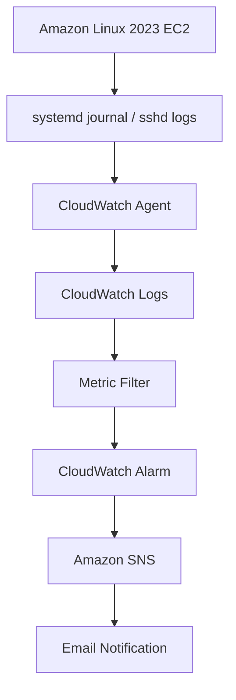

# Linux Endpoint Security Log Monitoring System

## 1. 概要

Terraformを使用してAWS上に構築した、LinuxのSSH認証失敗を検知し、メールで通知する監視システムです。

CloudWatch Logsに集約したSSH関連ログをメトリクスフィルターで監視し、一定回数以上の認証失敗を検知した場合に、CloudWatch AlarmとAmazon SNSを通じてメール通知する構成です。

## 2. 目的

- TerraformによるAWSインフラの構築・管理を学習する
- Linuxのログ収集と監視の仕組みを理解する
- ログからメトリクスを生成し、アラームと通知につなげる
- セキュリティ監視の基本的な検知・通知フローを実装する

## 3. 構成

## 4. 使用技術・AWSリソース

- AWS：VPC、Subnet、Internet Gateway、Route Table、Security Group
- Compute：Amazon EC2（Amazon Linux 2023）
- IAM：EC2用IAM Role、Instance Profile、IAM Policy Attachments
- Remote Access：AWS Systems Manager Session Manager
- Logging / Monitoring：CloudWatch Agent、CloudWatch Logs、Metric Filter、CloudWatch Alarm
- Notification：Amazon SNS
- IaC：Terraform
- CLI：AWS CLI

## 5. 検知・通知の仕組み

1. EC2上のsshd関連ログをCloudWatch Agent経由でCloudWatch Logsに送信
2. メトリクスフィルターで `body.MESSAGE` に `Failed password` を含むログを検知
3. 一致したログをカスタムメトリクス `SSHFailedPasswordCount` としてカウント
4. 5分間の合計が5以上になった場合、CloudWatch AlarmをALARM状態にする
5. アラームアクションからAmazon SNSを通じてメール通知する

### 主な設定値

| 項目 | 設定 |
|---|---|
| Log Group | `/security-monitor/linux/sshd` |
| Metric Namespace | `SecurityMonitor/Linux` |
| Metric Name | `SSHFailedPasswordCount` |
| Alarm Name | `SSHFailedPasswordAlarm` |
| 評価期間 | 300秒 |
| しきい値 | 5以上 |
| 統計方法 | Sum |

## 6. 検証結果

以下の合成ログをCloudWatch Logsに投入し、検知・通知フローを検証しました。

- `Failed password` を含むテストログの投入
- メトリクスフィルターによるカウントを確認
- 5件のテストログ投入後、CloudWatch AlarmがALARM状態になることを確認
- Amazon SNS経由でメールが届くことを確認
- `terraform plan` で `No changes` と表示され、Terraformの設定と管理対象リソースの差分がないことを確認

### 検証上の注意

今回の検知・通知テストでは、CloudWatch Logsへ合成したテストログを直接投入しました。実際のSSH認証失敗を発生させた検証ではありません。

## 7. セキュリティ上の配慮

- EC2へのSSH受信ポートをインターネットに公開せず、Session Managerによる接続を使用
- EC2にCloudWatch Logsへの送信とSession Manager接続に必要なIAM権限を付与
- Terraformの変数ファイルやstateファイルをGitの追跡対象から除外

## 8. 公開対象外のファイル

以下は機密情報や環境依存情報を含む可能性があるため、GitHubに公開しません。

- `terraform.tfvars`
- `terraform.tfstate` およびバックアップ
- `tfplan`
- `.terraform/`
- ローカルバックアップファイル

## 9. コストに関する注意

AWSリソースの利用状況に応じて料金が発生します。EC2を停止している場合でも、EBS、CloudWatch Logs、その他のリソースには料金が発生することがあります。

学習終了後は、AWSリソースの稼働状況と料金を確認してください。